<p align="center">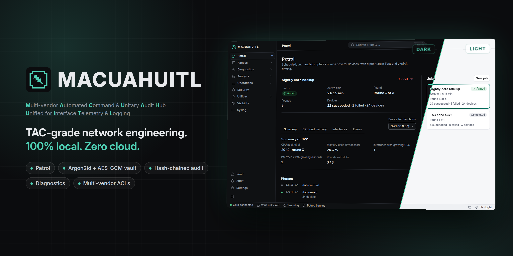</p>

<h3 align="center">A TAC in every network engineer's laptop.</h3>

<p align="center">
Collect evidence from Cisco devices on a schedule, analyze it, change the network safely<br>
and keep a verifiable record of everything. On your machine. Nowhere else.
</p>

<p align="center">
  
  
  
  
  
</p>

<p align="center">
  <a href="#install"><b>Install</b></a> &nbsp;·&nbsp;
  <a href="#quick-start"><b>Quick start</b></a> &nbsp;·&nbsp;
  <a href="#everything-inside">Everything inside</a> &nbsp;·&nbsp;
  <a href="#content-packs">Content packs</a> &nbsp;·&nbsp;
  <a href="#security">Security</a> &nbsp;·&nbsp;
  <a href="#what-it-does-not-do">What it does not do</a> &nbsp;·&nbsp;
  <a href="docs/roadmap.md">Roadmap</a>
</p>

<br>

<p align="center">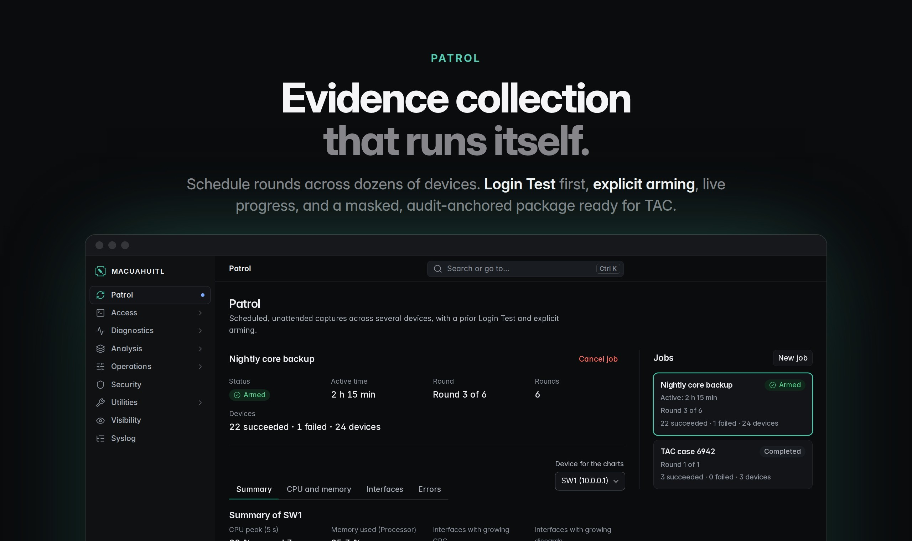</p>

**Patrol** collects evidence across many devices while you do something else. Every job starts with a **Login Test** and only runs once you **arm** it. You get live per-device progress, output per round or consolidated, secrets masked by default, and a `.zip` with a `manifest.json` that anchors the audit chain. Ready to hand to TAC.

<br>

<p align="center">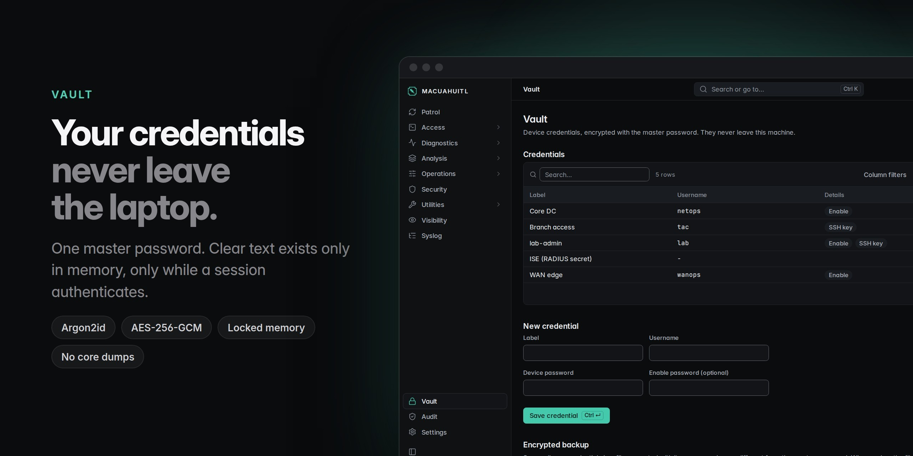</p>

**The vault** keeps device credentials under one master password, with Argon2id and AES-256-GCM. Passwords are in clear text only in memory, and only for the moment a session authenticates. They never touch a log, an output or an error message.

<br>

<p align="center">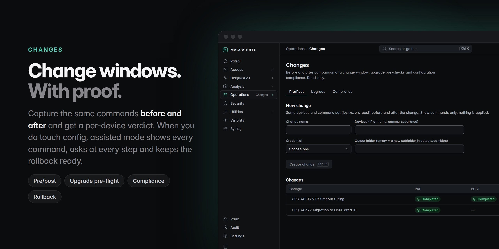</p>

**Changes** come with proof. Capture the same commands before and after a window and get a verdict per device, plus upgrade pre-flight and compliance against golden templates. Anything that touches configuration runs in **assisted change mode**: every command shown first, every step confirmed, the rollback ready.

<br>

<p align="center">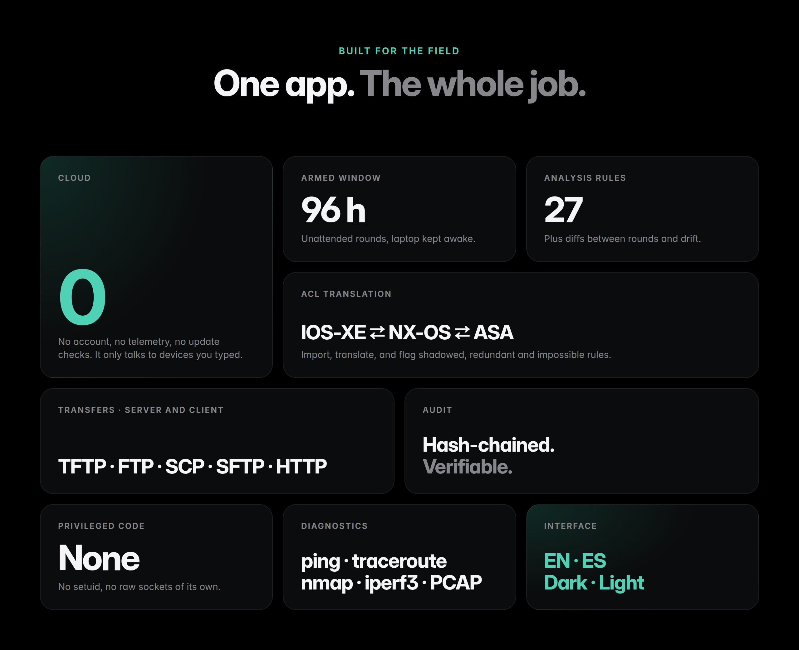</p>

<br>

<p align="center">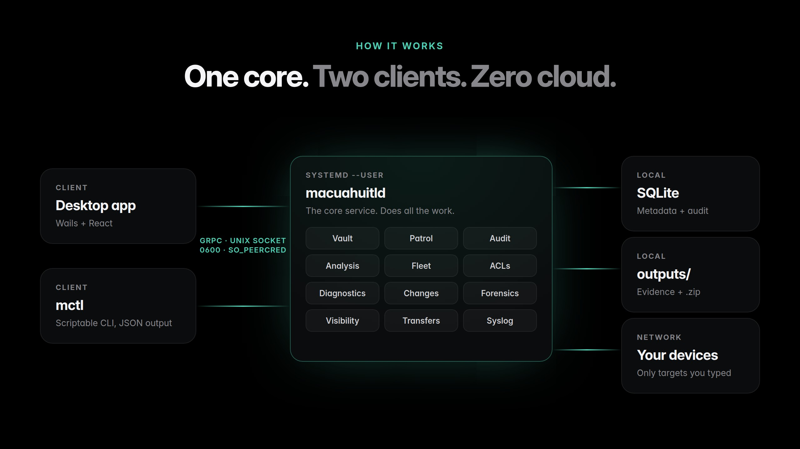</p>

- **One core, two clients.** `macuahuitld` runs as a systemd user service and does all the work. The desktop app (Wails + React) and `mctl` are thin clients over gRPC on a Unix socket (mode `0600`, caller UID checked with `SO_PEERCRED`).
- **Local storage only.** Metadata and the audit log live in SQLite (pure Go, no cgo). Evidence lives in the output folder you choose.
- **Playbooks** define what gets collected (`tac-baseline`, `cpu-alta`, `errores-interfaz`, `topologia`, `upgrade-check`, …). Every command passes a per-platform deny list, so a collection can never change configuration. A few ship inside the binary; the rest come in [content packs](#content-packs) you install per technology.

## More screens

<table>
  <tr>
    <td width="50%">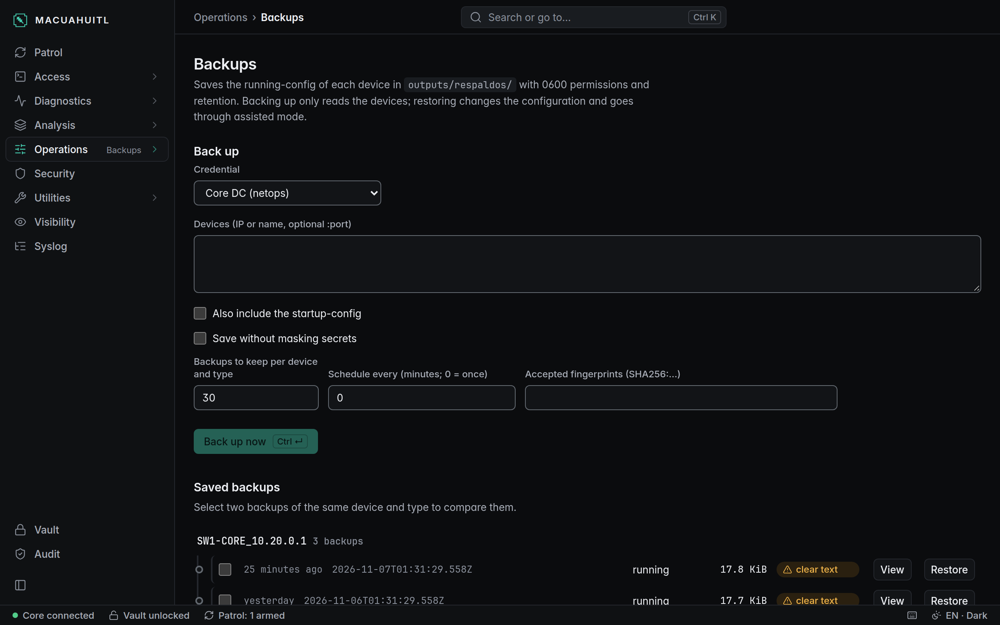<br><sub><b>Backups.</b> Scheduled or on-demand config backups, diffed before any restore.</sub></td>
    <td width="50%">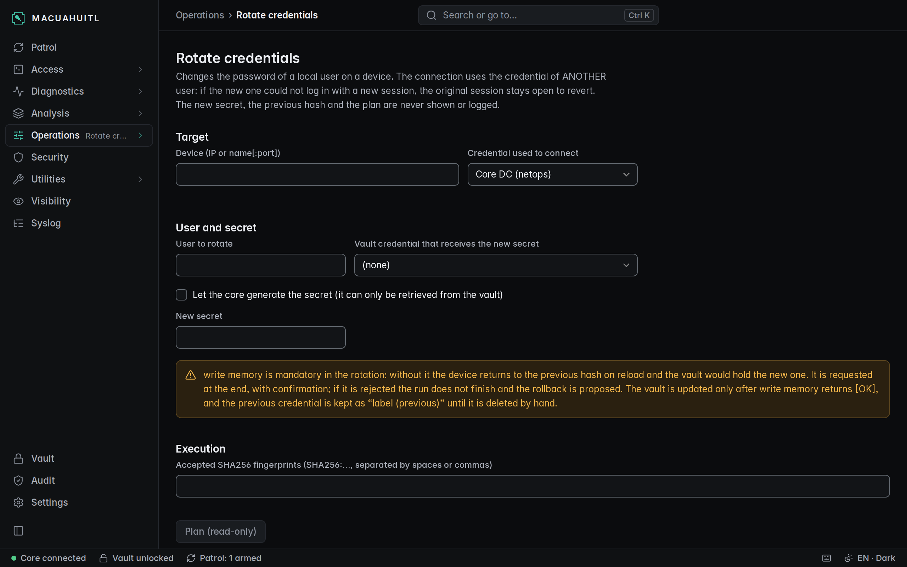<br><sub><b>Credential rotation.</b> Rotate local passwords across the fleet and verify the new access before closing.</sub></td>
  </tr>
  <tr>
    <td>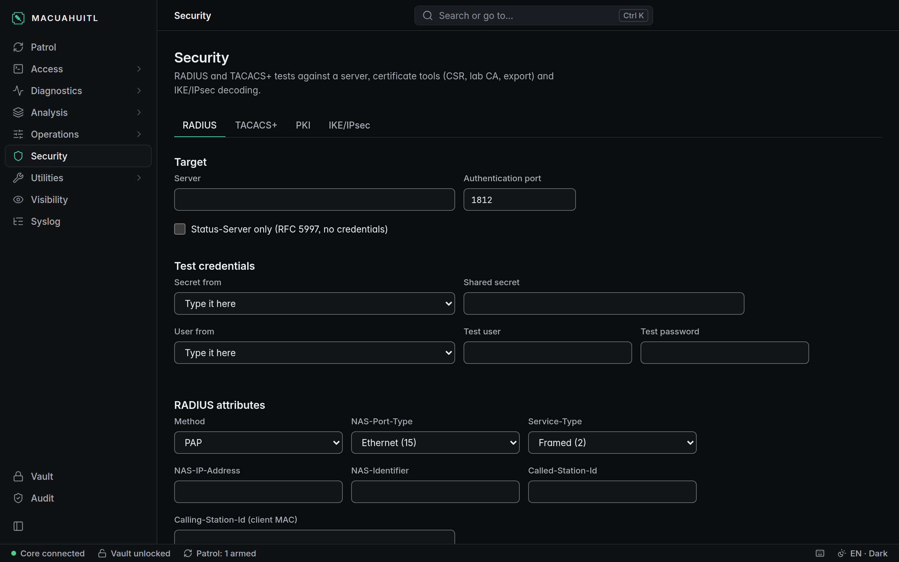<br><sub><b>Security.</b> Test RADIUS and TACACS+ with credentials from the vault.</sub></td>
    <td>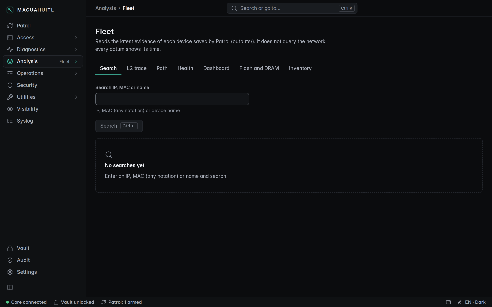<br><sub><b>Fleet.</b> Search, L2 trace, path, health, dashboard, flash and inventory from evidence already collected.</sub></td>
  </tr>
</table>

<details>
<summary><b>Light theme</b></summary>
<br>
<table>
  <tr>
    <td width="50%">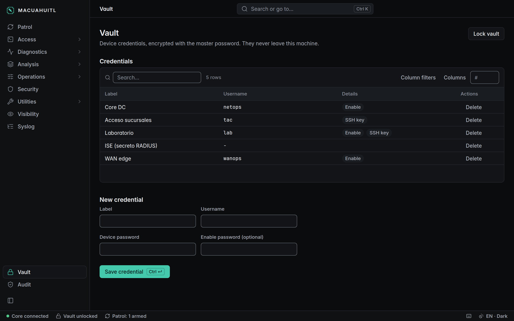<br><sub>Dark</sub></td>
    <td width="50%">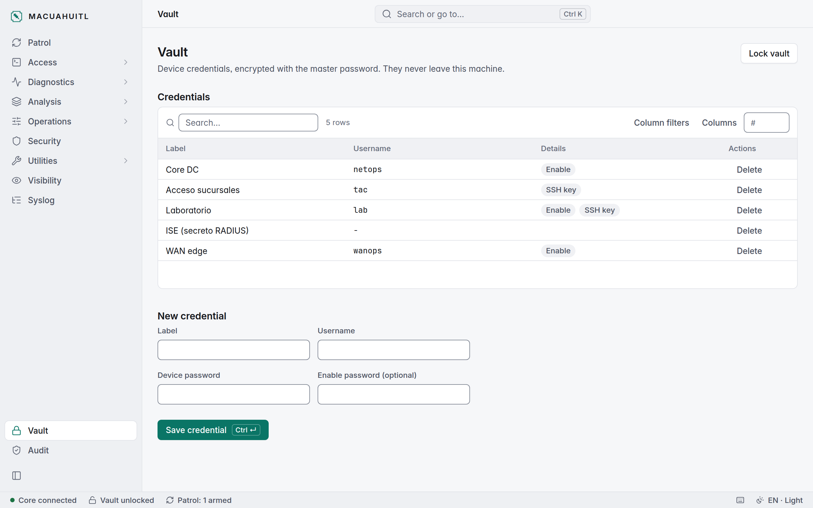<br><sub>Light</sub></td>
  </tr>
</table>
</details>

## Everything inside

| Area | What you get |
|---|---|
| **Patrol** | Scheduled, unattended collection across many devices. Mandatory Login Test, explicit arming, live progress, output per round or consolidated, `.zip` package with `manifest.json`. |
| **Vault** | Local credential store. Argon2id + AES-256-GCM, data key in locked memory. |
| **Audit** | Hash-chained log of every action. `mctl audit verify` proves it is intact; each package carries an anchor of the chain. |
| **Access** | Multi-tab SSH terminal with session recording. Serial console for first boot, recovery and ROMMON. |
| **Diagnostics** | ping, traceroute, nmap, iperf3 and local packet capture, all audited. |
| **Analysis** | 27 rules over collected evidence, diff between rounds, configuration drift, correlated timeline, PCAP summary (TCP, DNS, TLS, ICMP, CDP/LLDP, ARP), DNS and TLS inspection. |
| **Fleet** | Find any IP, MAC or hostname, trace a MAC to its access port, L3/L2 path between two hosts, interface health, morning dashboard, flash/DRAM headroom, exportable inventory. |
| **ACLs** | Import, analyze (shadowed, redundant, impossible rules) and translate between IOS-XE, NX-OS and ASA. |
| **Operations** | Assisted change mode, read-only batches, access-port provisioning, config snippets, pre/post checks, upgrade pre-flight, golden templates and hardening, backup and restore, config cleaner, bulk credential rotation. |
| **Forensics** | Crashinfo analysis, Cisco message knowledge base, silent flapping detection, debug filtering, per-process memory leaks between rounds. |
| **Visibility** | CDP/LLDP topology (SVG), SNMP polling and traps, NetFlow/IPFIX/sFlow, gNMI. |
| **Security** | RADIUS and TACACS+ testers, lab PKI (keys, CSR, CA, PKCS#12), IKE/IPsec debug decoder. |
| **Field tools** | Temporary TFTP/HTTP/FTP/SCP/SFTP servers and clients, MD5/SHA-512 verification. |
| **Calculators** | Subnets, VLSM, summarization, wildcards, IPv6, MTU/MSS, TCP throughput, DSCP/QoS, optical budget, BGP best path. |
| **Syslog** | Local receiver that feeds the timeline. |
| **Content packs** | Playbooks and scripts per technology in signed `.mpack` bundles. Install only what you use; read-only content, checked on install. |

### A Patrol job, step by step

1. **Create** the job: targets, credential, playbooks, output folder, schedule and window (1 to 96 hours).
2. **Login Test** every device. New SSH host keys are shown for you to confirm. A changed key blocks by default.
3. **Arm** it. The vault stays usable for the window and the laptop is kept awake while rounds run.
4. **Watch** it live: per-device status, progress and phases.
5. **Collect** the package: evidence, masked secrets and a `manifest.json` anchored to the audit chain.

## Content packs

Playbooks and scripts come in **content packs** (`.mpack`), one per technology. Install the IOS-XE pack and skip the firewall one; add ACI and leave wireless out. Content ships on its own schedule, without a new core release.

```sh
mctl pack install oom-ios-xe-1.0.0.mpack    # from the release page; the app never downloads anything
mctl pack list                              # installed packs, version, official or third-party
mctl pack show oom/ios-xe                   # manifest and the pack's own README
mctl pack remove oom/ios-xe
```

- **Official packs** (`oom/*`) are signed with Ed25519 and published as release assets with their README and checksum. The public key is compiled into the core.
- **Third-party packs** install only with `--allow-unsigned` (or a confirmation in the app) and carry their author's prefix in every ID, so they can never take over an official playbook.
- **Every pack is read-only content.** Each playbook command passes the same deny list as built-in ones, on install and again at every start. Nothing executable travels in a pack, and change templates stay in the core.
- **Each pack carries its own README** with what it contains and how to load it.

Official packs today: `oom/ios-xe`. Classic IOS is next; NX-OS, ASA/FTD, ACI, wireless, ISE and SD-Access follow as each platform gets its driver and read-only rules. The format is defined in [ADR 0010](docs/adr/0010-paquetes-de-contenido.md).

> [!NOTE]
> Content packs arrive with **v0.3.0**. From that version, 52 IOS-XE playbooks move out of the binary into `oom/ios-xe`: install it after upgrading. A job that asks for a playbook from a missing pack fails with a message naming the pack to install.

## Security

Promises anyone can verify with the [auditor's guide](docs/security/AUDIT_GUIDE.md):

1. No credential is ever written to disk in clear text.
2. No credential appears in logs, the audit log, outputs, error messages or memory dumps.
3. The app only connects to destinations the engineer typed. No telemetry, no update checks.
4. The master password is never stored. Lose it and the vault cannot be recovered, by design.

Under the hood: Argon2id tuned to about 1 s and 256 MiB, AES-256-GCM with associated data, the data key in locked memory, core dumps disabled, a `Secret` type redacted by every formatter, a no-egress check in CI and an egress guard at runtime, reproducible builds with SBOM, pinned dependencies and `govulncheck`, and official content packs signed with Ed25519. No project code runs with privileges: capture and scans use the system's `dumpcap`, `nmap`, `iperf3` and `tracepath`.

Known limits are declared, not hidden, in the [threat model](docs/security/THREAT_MODEL.md). To report a vulnerability, see [SECURITY.md](SECURITY.md).

## What it does not do

- **No cloud.** No account, no sync, no telemetry, no automatic updates. Content packs are downloaded by hand.
- **Not a 24/7 NMS.** It is an engineer's tool on a laptop. Patrol collects while a job is armed and the machine is on.
- **Never changes configuration on its own.** Patrol and batches are read-only. Every change goes through assisted mode, with your confirmation.
- **No privileged code.** No setuid helpers, no raw sockets of its own, no embedded Wireshark or tshark.
- **Cannot protect you from malware running as your own user** while the vault is open. No user-space app can.
- **Cannot recover a lost master password.**
- **Linux only**, for now.

## Supported platforms

| Platform | Status |
|---|---|
| Cisco IOS / IOS-XE | ✅ Patrol, analysis, fleet, operations |
| ACLs: IOS-XE, NX-OS, ASA | ✅ Import, analysis, translation |
| NX-OS, Catalyst 9000, ASA | 🔜 Next, needs real device transcripts |
| WLC 9800 / AireOS, ISE, FTD/Firepower, SD-Access | 🗺️ Planned |

> [!NOTE]
> **Pre-1.0.** Parsers and analysis rules are being validated against real devices. Expect rough edges, and please report any output that is parsed wrong.

## Install

`.deb` and `.rpm` packages are attached to each [release](../../releases), built reproducibly with an SBOM.

```sh
sudo dpkg -i macuahuitl_*.deb                 # or: sudo rpm -i macuahuitl-*.rpm
systemctl --user enable --now macuahuitld     # as the user who will use it
```

| Need | Packages |
|---|---|
| Desktop app | `libwebkit2gtk-4.1-0` (Debian/Ubuntu) or `webkit2gtk4.1` (Fedora/RHEL) |
| Diagnostics | `nmap`, `iperf3`, `wireshark-common` (`dumpcap`, with your user in the `wireshark` group) |

`ping` and `tracepath` come with the system. The core and `mctl` have no system dependencies.

## Quick start

```sh
mctl pack install oom-ios-xe-1.0.0.mpack     # v0.3.0+: the IOS-XE playbooks (from the release page)
mctl vault create                           # set the master password (no echo)
mctl cred add --label lab --user admin      # device credential
mctl job create -f job.yaml                 # returns the job ID
mctl job logintest ID                       # Login Test; shows SSH fingerprints to confirm
mctl job arm --accept SHA256:... ID         # arm the job
mctl job watch ID                           # live status until the package is ready
mctl audit verify                           # check the audit chain
```

<details>
<summary><b>Example <code>job.yaml</code></b></summary>

```yaml
name: case-123
targets:
  - address: 192.0.2.10
    device_id: core-1
default_credential_id: <ID from mctl cred list>
playbook_ids: [ios-xe/tac-baseline]
output_dir: /home/me/MACUAHUITL/outputs
window_hours: 8
schedule:
  interval_seconds: 1800
  rounds: 12
```
</details>

<details>
<summary><b>More commands</b></summary>

```sh
mctl find 00:1a:2b:3c:4d:5e                          # where is this MAC, across the fleet
mctl trace 10.20.30.40                               # follow it to the access port
mctl health interfaces                               # only interfaces with problems
mctl fleet inventory --csv                           # models, serials, versions, SFPs
mctl acl convert --from asa --to nx-os -f edge.txt   # translate an ACL
mctl acl analyze --vendor ios-xe -f edge.txt         # shadowed, redundant, impossible rules
mctl diag ping 192.0.2.10 -o count=10                # also traceroute, nmap, iperf3, pcap
mctl calc vlsm 10.0.0.0/24 users=100 voice=50 mgmt=10
mctl --help                                          # everything else
```
</details>

## Build from source

Requires Go 1.27+, [Task](https://taskfile.dev) and Node 24 for the UI. The desktop app also needs the WebKitGTK development packages (see [deploy/packaging](deploy/packaging/README.md)).

```sh
task test       # Go tests
task lint
task build      # macuahuitld and mctl
task ui-test    # UI tests
task ui-build   # desktop app
```

## Docs

- [Roadmap](docs/roadmap.md): what is built and the phases ahead (L2/L3 maps, optics, MOP generator, upgrades, advanced routing, MPLS/SR/EVPN, TAC report packaging)
- [Architecture design](docs/architecture/2026-11-02-macuahuitl-architecture-design.md) · [Decision records](docs/adr/)
- [Threat model](docs/security/THREAT_MODEL.md) · [Cryptography](docs/security/CRYPTO.md) · [Auditor's guide](docs/security/AUDIT_GUIDE.md)

Design documents are currently written in Spanish.

## Contributing

Issues and pull requests are welcome. See [CONTRIBUTING.md](CONTRIBUTING.md).

## License

[Apache-2.0](LICENSE). Use, modify and distribute MACUAHUITL, commercially too, keeping the [NOTICE](NOTICE).

The name **MACUAHUITL** and its icon are not covered by the license: a modified version must use a different name. See [MARCA.md](MARCA.md).
