<p align="center">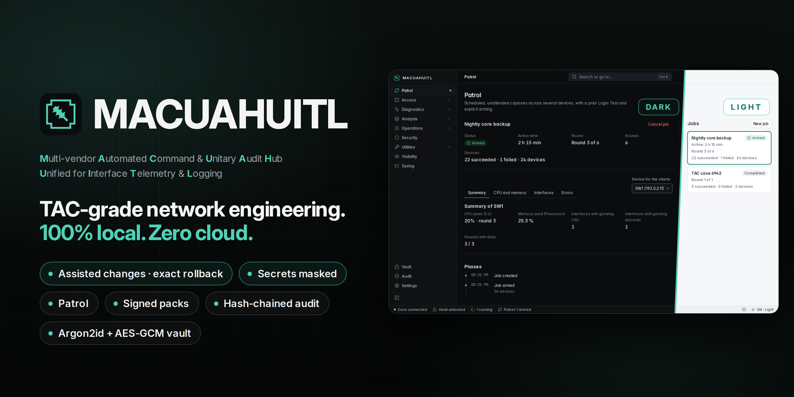</p>

<h3 align="center">A TAC in every network engineer's laptop.</h3>

<p align="center">
A Linux desktop app for network and TAC engineers. Collect evidence from Cisco devices on a schedule,<br>
analyze it, change the network safely and keep a verifiable record of everything. On your machine. Nowhere else.
</p>

<p align="center">
  
  
  
  
  
</p>

<p align="center">
  <a href="#install"><b>Install</b></a> &nbsp;·&nbsp;
  <a href="#quick-start"><b>Quick start</b></a> &nbsp;·&nbsp;
  <a href="#safe-by-design">Safe by design</a> &nbsp;·&nbsp;
  <a href="#everything-inside">Everything inside</a> &nbsp;·&nbsp;
  <a href="#content-packs">Content packs</a> &nbsp;·&nbsp;
  <a href="#supported-platforms-and-packs">Platforms</a> &nbsp;·&nbsp;
  <a href="#security">Security</a> &nbsp;·&nbsp;
  <a href="#what-it-does-not-do">What it does not do</a> &nbsp;·&nbsp;
  <a href="docs/roadmap.md">Roadmap</a>
</p>

### Why not a folder of scripts?

Scripts collect. MACUAHUITL also runs the collection for you, analyzes it, packages it for TAC and changes the network with guard rails:

- **Collection that runs itself.** Login Test first, explicit arming, rounds on a schedule, and a `.zip` with a `manifest.json` anchored to the audit log.
- **Analysis included.** 44 analysis rules, round-to-round differences and a correlated timeline over the evidence you collected.
- **Every change is planned first.** Each line and its exact rollback are shown before anything is sent, and you confirm one step at a time. [How it stays safe](#safe-by-design).
- **Local and accountable.** Credentials in an encrypted vault, secrets masked in the evidence, every action in a hash-chained audit log.

<br>

<p align="center">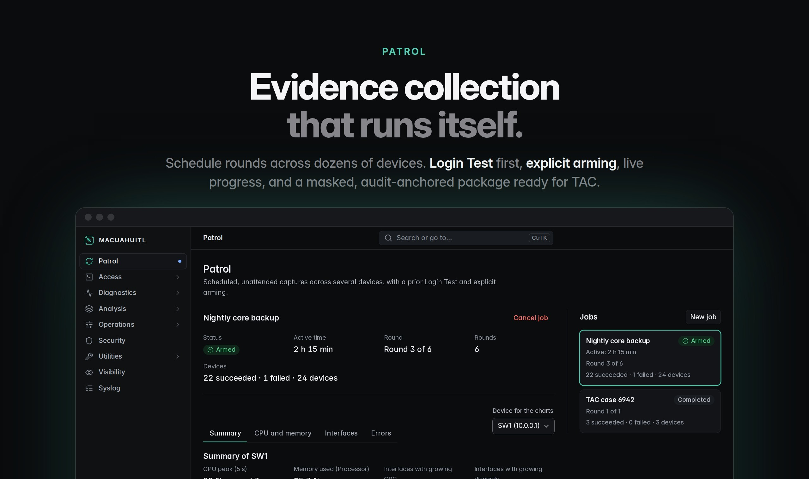</p>

**Patrol** collects evidence across many devices while you do something else. Every job starts with a **Login Test** and only runs once you **arm** it. You get live per-device progress, output per round or consolidated, secrets masked by default, and a `.zip` with a `manifest.json` that anchors the audit chain. Ready to hand to TAC.

<br>

<p align="center">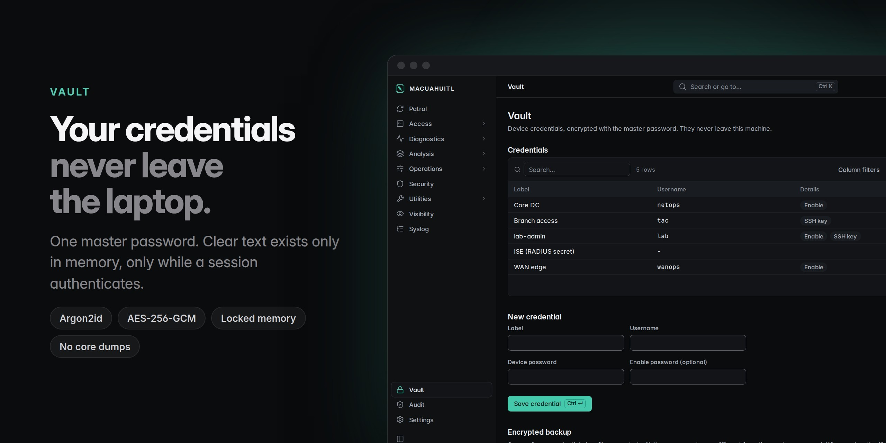</p>

**The vault** keeps device credentials under one master password, with Argon2id and AES-256-GCM. Passwords are in clear text only in memory, and only for the moment a session authenticates. They never touch a log, an output or an error message.

<br>

<p align="center">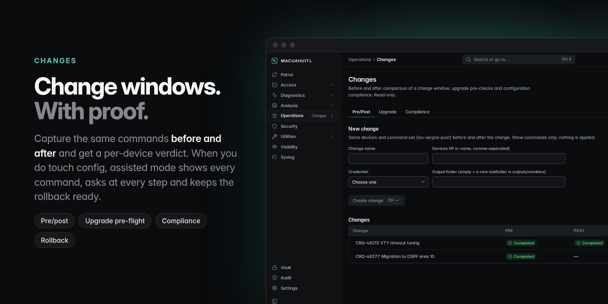</p>

**Changes** come with proof. Capture the same commands before and after a window and get a verdict per device, plus upgrade pre-flight and compliance against golden templates. Anything that touches configuration runs in **assisted change mode**: every command shown first, every step confirmed, the rollback ready.

<table>
  <tr>
    <td width="50%">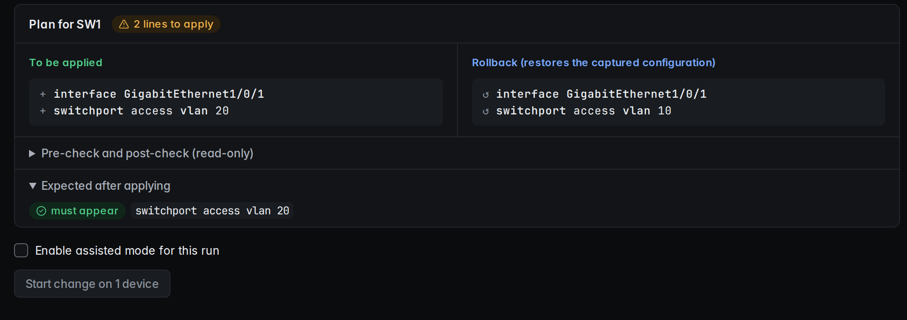<br><sub><b>The plan.</b> The lines to send, next to the rollback that restores the captured configuration, and what the post-check expects.</sub></td>
    <td width="50%">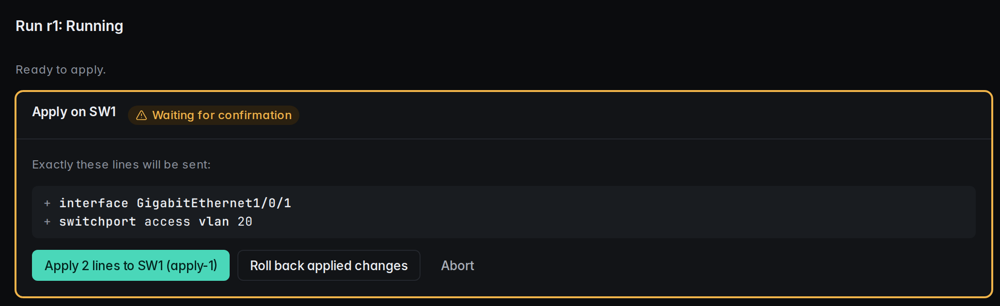<br><sub><b>One step at a time.</b> Each step waits for you with exactly the lines it will send. Roll back or abort at any point.</sub></td>
  </tr>
</table>

### Safe by design

Each of these is in the release notes, with what was checked on a real device:

- **Your own session is off limits.** Port templates refuse the port your SSH session arrives on. The SVI, static route and loopback templates refuse a prefix that holds your address, and the vty ACL template refuses a list that would lock you out. On a Catalyst 3560-CX, `shutdown` on the session's port was refused with *"Gi0/3 is the port this session arrives on"* ([v0.6.5](../../releases/tag/v0.6.5)).
- **Rollback means the configuration as it was.** The write templates were applied, verified and rolled back in the lab runs of [v0.5.4](../../releases/tag/v0.5.4) (Cisco Modeling Labs and a Catalyst 3560-CX) and [v0.6.4](../../releases/tag/v0.6.4) (Catalyst 3560-CX). The configuration was identical after every rollback.
- **An unknown error stops the change.** Any unrecognized IOS `% …` reply in configuration mode stops the apply and offers the rollback. On the 3560-CX, five templates were applied and rolled back with no false stop ([v0.6.5](../../releases/tag/v0.6.5)).
- **Recorded before it is sent.** The lines of a change are written to the audit log before they reach the device, and a core restart in the middle of an apply leaves a state the saved rollback can still check ([v0.6.5](../../releases/tag/v0.6.5)).
- **Secrets are masked** in evidence, terminal recordings, logs and syslog, including abbreviated IOS forms typed at the terminal (`ena sec lev 15 …`, `snmp-s ho … ver 2c …`, `tacacs-ser k …`). Permanent tests check every change against a frozen copy of the v0.6.5 masking, so nothing masked before can become visible ([v0.6.6](../../releases/tag/v0.6.6)). Known limitations, such as `tac k …` and a multi-word secret repeated later in the output, are listed in the [v0.6.6 notes](../../releases/tag/v0.6.6).

<p align="center">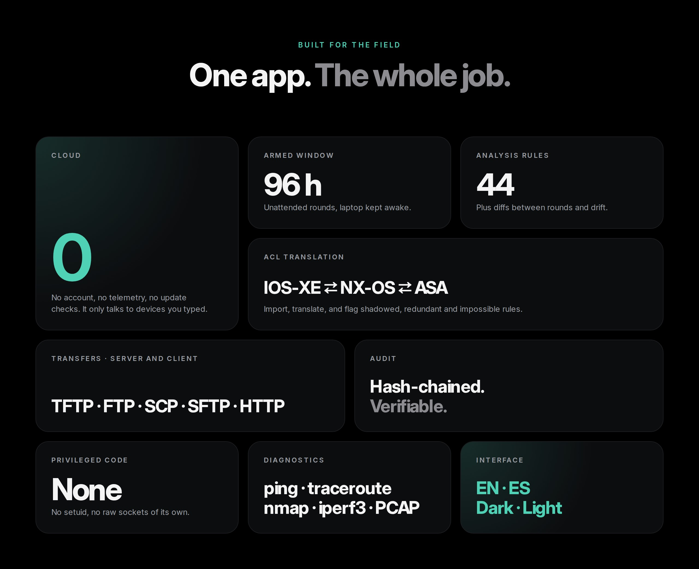</p>

<br>

<p align="center">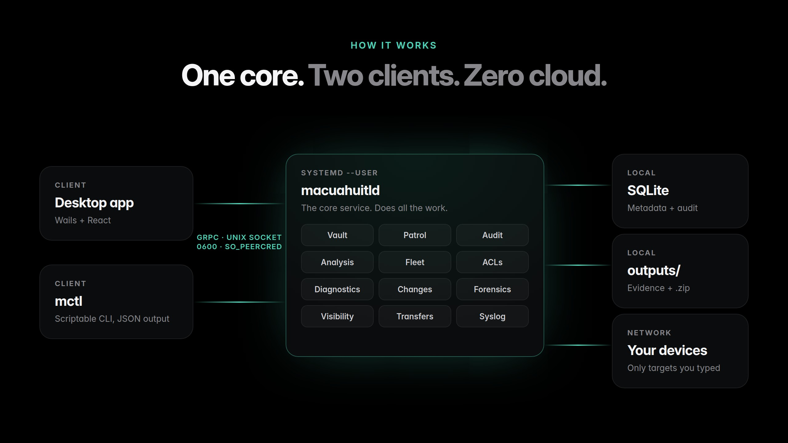</p>

- **One core, two clients.** `macuahuitld` runs as a systemd user service and does all the work. The desktop app (Wails + React) and `mctl` are thin clients over gRPC on a Unix socket (mode `0600`, caller UID checked with `SO_PEERCRED`).
- **Local storage only.** Metadata and the audit log live in SQLite (pure Go, no cgo). Evidence lives in the output folder you choose.
- **Playbooks** define what gets collected (`tac-baseline`, `cpu-alta`, `errores-interfaz`, `topologia`, `upgrade-check`, …). Every command passes a per-platform deny list, so a collection can never change configuration. A few ship inside the binary; the rest come in [content packs](#content-packs) you install per technology.

## More screens

<table>
  <tr>
    <td width="50%">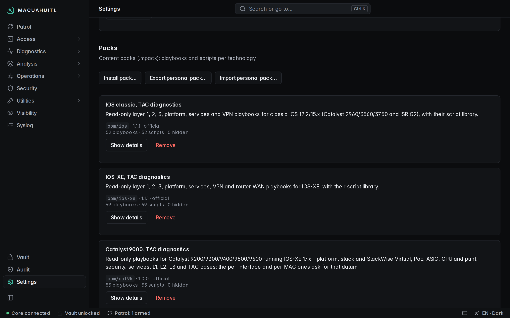<br><sub><b>Content packs.</b> Eleven signed official packs, installed and removed from Settings or with <code>mctl pack</code>.</sub></td>
    <td width="50%">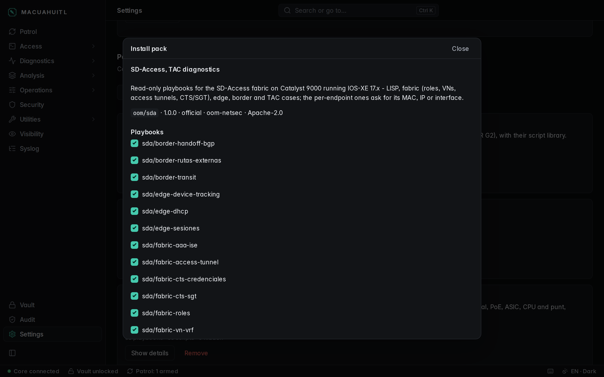<br><sub><b>Install preview.</b> See every playbook and script a pack brings, and hide what you do not need, before installing.</sub></td>
  </tr>
  <tr>
    <td>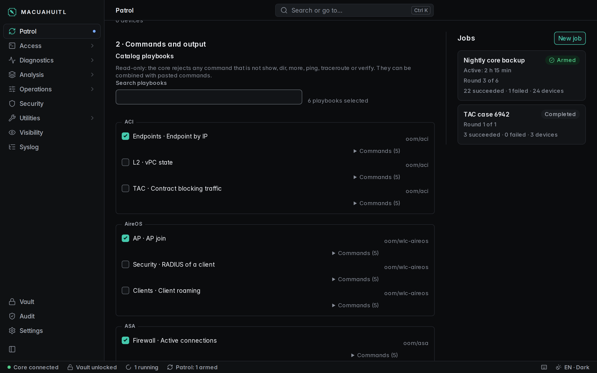<br><sub><b>Playbook picker.</b> Playbooks from every installed pack, grouped by area and labeled with their pack.</sub></td>
    <td>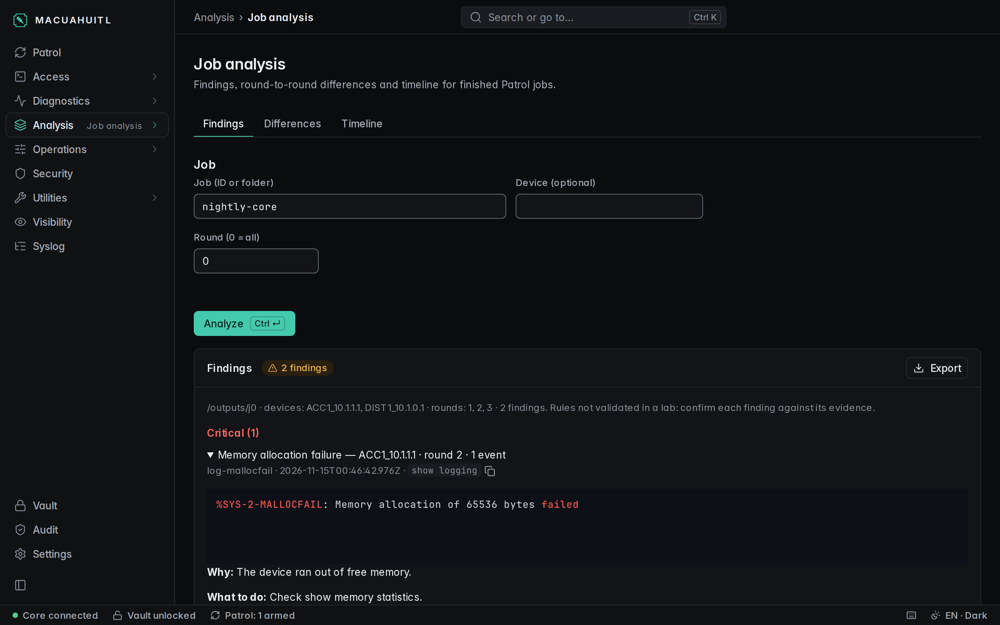<br><sub><b>Job analysis.</b> Findings, round-to-round differences and a timeline for finished Patrol jobs, each finding with its evidence.</sub></td>
  </tr>
  <tr>
    <td>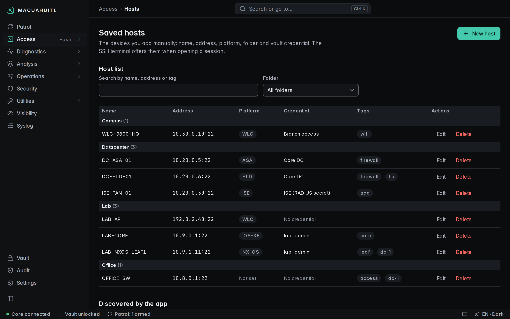<br><sub><b>Saved hosts.</b> Your devices with platform, folder, tags and vault credential, ready for the SSH terminal.</sub></td>
    <td>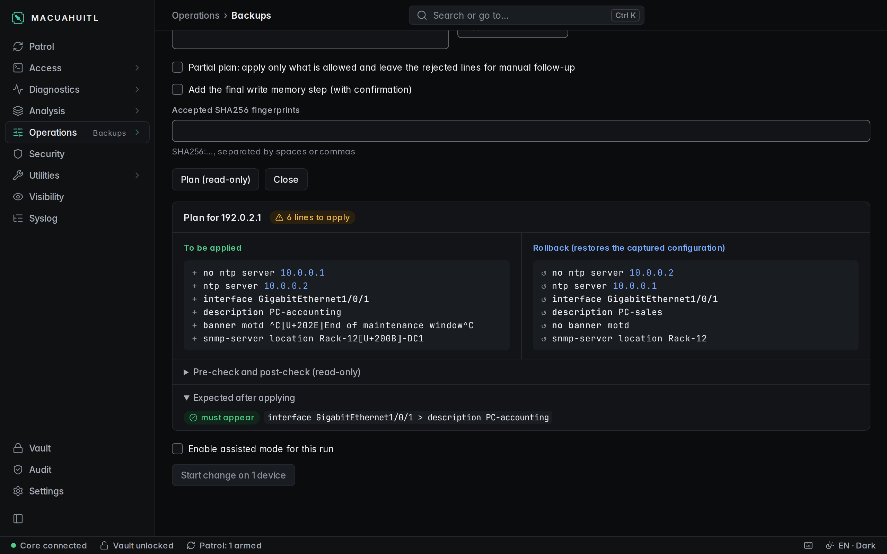<br><sub><b>Nothing hidden.</b> Bidi and zero-width characters are shown as ⟦U+202E⟧ before you confirm a change, and in the paste confirmation.</sub></td>
  </tr>
  <tr>
    <td width="50%">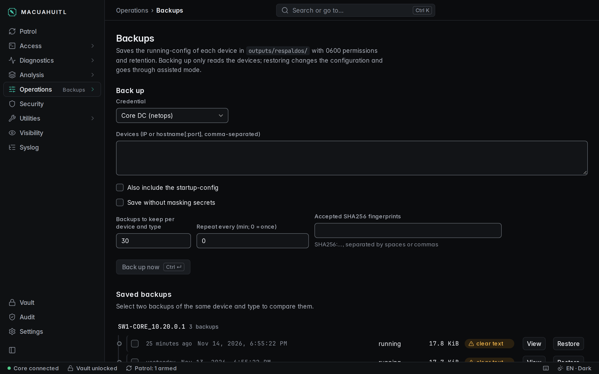<br><sub><b>Backups.</b> Scheduled or on-demand config backups, diffed before any restore.</sub></td>
    <td width="50%">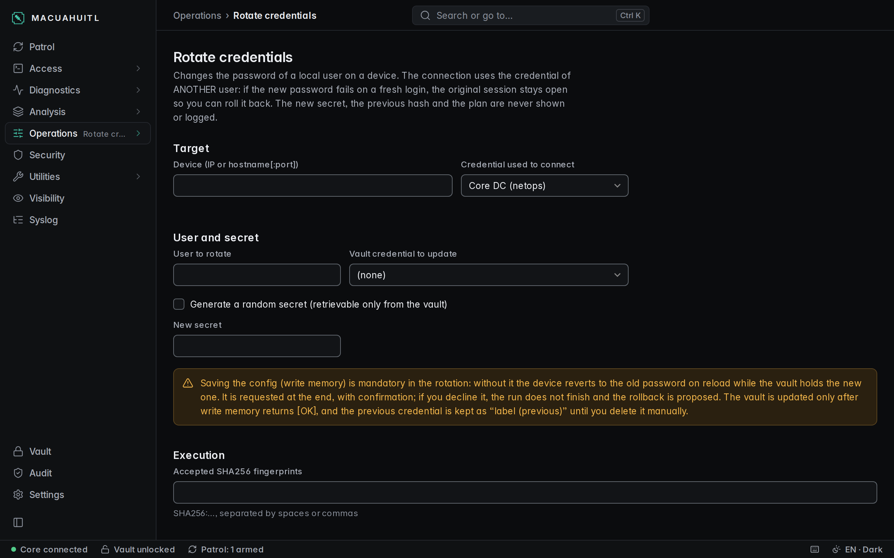<br><sub><b>Credential rotation.</b> Rotate a local password on a device and verify the new access before closing.</sub></td>
  </tr>
  <tr>
    <td>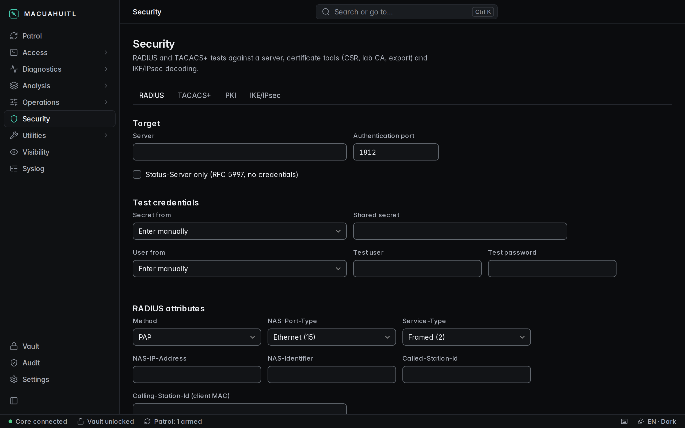<br><sub><b>Security.</b> Test RADIUS and TACACS+ with credentials from the vault.</sub></td>
    <td>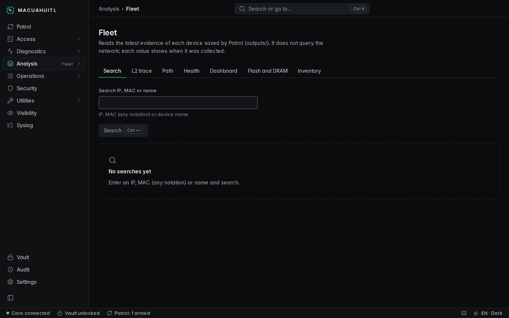<br><sub><b>Fleet.</b> Interface health, morning check, search, L2 trace, path, flash and inventory from evidence already collected.</sub></td>
  </tr>
</table>

<details>
<summary><b>Light theme</b></summary>
<br>
<table>
  <tr>
    <td width="50%">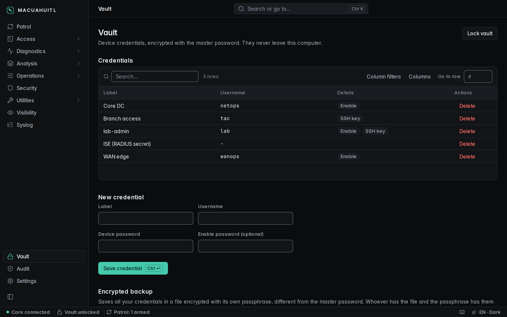<br><sub>Dark</sub></td>
    <td width="50%">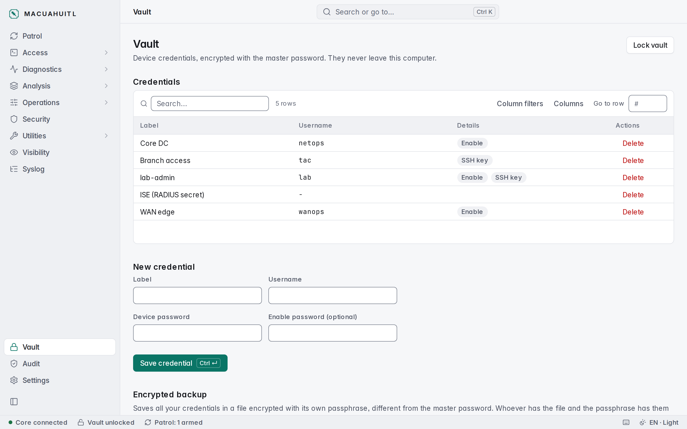<br><sub>Light</sub></td>
  </tr>
</table>
</details>

## Everything inside

| Area | What you get |
|---|---|
| **Patrol** | Scheduled, unattended collection across many devices. Mandatory Login Test, explicit arming, live progress, output per round or consolidated, `.zip` package with `manifest.json`. |
| **Vault** | Local credential store. Argon2id + AES-256-GCM, data key in locked memory. |
| **Audit** | Hash-chained log of every action. `mctl audit verify` proves it is intact; each package carries an anchor of the chain. |
| **Access** | Multi-tab SSH terminal with session recording, saved hosts, and a paste confirmation that shows control and hidden characters. Serial console for first boot, recovery and ROMMON. |
| **Diagnostics** | ping, traceroute, nmap, iperf3 and local packet capture, all audited. |
| **Analysis** | Job analysis: 44 rules over collected evidence, diff between rounds, configuration drift, correlated timeline, PCAP summary (TCP, DNS, TLS, ICMP, CDP/LLDP, ARP), DNS and TLS inspection. |
| **Fleet** | Find any IP, MAC or hostname, trace a MAC to its access port, L3/L2 path between two hosts, interface health, morning dashboard, flash/DRAM headroom, exportable inventory. |
| **ACLs** | Import, analyze (shadowed, redundant, impossible rules) and translate between IOS-XE, NX-OS and ASA. |
| **Operations** | Assisted change mode, read-only batches, access-port provisioning, config snippets, pre/post checks, upgrade pre-flight, golden templates and hardening, backup and restore, config cleaner, bulk credential rotation. |
| **Forensics** | Crashinfo analysis, Cisco message knowledge base, silent flapping detection, debug filtering, per-process memory leaks between rounds. |
| **Visibility** | CDP/LLDP topology (SVG), SNMP polling and traps, NetFlow/IPFIX/sFlow, gNMI. |
| **Security** | RADIUS and TACACS+ testers, lab PKI (keys, CSR, CA, PKCS#12), IKE/IPsec debug decoder. |
| **Field tools** | Temporary TFTP/HTTP/FTP/SCP/SFTP servers and clients, MD5/SHA-512 verification. |
| **Calculators** | Subnets, VLSM, summarization, wildcards, IPv6, MTU/MSS, TCP throughput, DSCP/QoS, optical budget, BGP best path. |
| **Syslog** | Local receiver that feeds the timeline. |
| **Content packs** | Eleven official packs, about 600 read-only playbooks across eleven Cisco platforms, in signed `.mpack` bundles. Install only what you use; every playbook is checked on install and at every start. |

### A Patrol job, step by step

1. **Create** the job: targets, credential, playbooks, output folder, schedule and window (1 to 96 hours).
2. **Login Test** every device. New SSH host keys are shown for you to confirm. A changed key blocks by default.
3. **Arm** it. The vault stays usable for the window and the laptop is kept awake while rounds run.
4. **Watch** it live: per-device status, progress and phases. A command asked for by several playbooks (or typed twice) runs once per device and round, and the report credits it to each playbook that asked for it.
5. **Collect** the package: evidence, masked secrets and a `manifest.json` anchored to the audit chain.

## Content packs

Playbooks and scripts come in **content packs** (`.mpack`), one per technology. Install the ones for the platforms you work on and leave the rest out. Each pack has its own version, so newer content installs on the core you already have. Manage them in **Settings → Packs** (install with a preview, remove, hide single playbooks or scripts, export your own as a personal pack) or with `mctl pack`.

```sh
mctl pack inspect oom-ios-xe-*.mpack       # preview: what it brings and what it replaces
mctl pack install oom-ios-xe-*.mpack       # from the release page; the app never downloads anything
mctl pack list                              # installed packs, version, official or third-party
mctl pack show oom/ios-xe                   # manifest and the pack's own README
mctl pack remove oom/ios-xe
```

- **Official packs** (`oom/*`) are signed with Ed25519 and published as assets of every release, each with its README and checksum. The public key is compiled into the core. Pack updates that need no core change ship on their own, in **Content packs** releases tagged `packs-YYYY-MM-DD`, and install on the latest core.
- **An official pack always wins.** If a third-party pack collides with an official one, installing the official pack shows which third-party packs it would remove and asks you to confirm.
- **Third-party packs** install only with `--allow-unsigned` (or a confirmation in the app) and carry their publisher prefix in every ID, so they can never take over an official playbook.
- **Playbooks stay read-only.** Every playbook command in a pack passes the same deny list as the built-in ones, on install and again at every start. Scripts are never run: the terminal pastes them without pressing Enter, like the built-in library. Nothing executable travels in a pack, and change templates stay in the core.
- **Each pack carries its own README** with what it contains and how to load it.

The official packs and the platforms they cover are listed in [Supported platforms and packs](#supported-platforms-and-packs). The format is defined in [ADR 0010](docs/adr/0010-paquetes-de-contenido.md).

## Security

Promises anyone can verify with the [auditor's guide](docs/security/AUDIT_GUIDE.md):

1. No credential is ever written to disk in clear text.
2. No credential appears in logs, the audit log, outputs, error messages or memory dumps.
3. The app only connects to destinations the engineer typed. No telemetry, no update checks.
4. The master password is never stored. Lose it and the vault cannot be recovered, by design.

Under the hood: Argon2id tuned to about 1 s and 256 MiB, AES-256-GCM with associated data, the data key in locked memory, core dumps disabled, a `Secret` type redacted by every formatter, a no-egress check in CI and an egress guard at runtime, reproducible builds with SBOM, pinned dependencies and `govulncheck`, and official content packs signed with Ed25519. No project code runs with privileges: capture and scans use the system's `dumpcap`, `nmap`, `iperf3` and `tracepath`.

Known limits are declared, not hidden, in the [threat model](docs/security/THREAT_MODEL.md). To report a vulnerability, see [SECURITY.md](SECURITY.md).

## What it does not do

- **No cloud.** No account, no sync, no telemetry, no automatic updates. Content packs are downloaded by hand.
- **Not a 24/7 NMS.** It is an engineer's tool on a laptop. Patrol collects while a job is armed and the machine is on.
- **Never changes configuration on its own.** Patrol and batches are read-only. Every change goes through assisted mode, with your confirmation.
- **No privileged code.** No setuid helpers, no raw sockets of its own, no embedded Wireshark or tshark.
- **Cannot protect you from malware running as your own user** while the vault is open. No user-space app can.
- **Cannot recover a lost master password.**
- **Linux only**, for now. Windows and macOS come after 1.0.0 (see the [roadmap](docs/roadmap.md)).
- **English** by default (app, core and `mctl`). Spanish is available in Settings, and with `mctl --lang es`.

## Supported platforms and packs

Each platform is covered by an official content pack. Install the packs you need; playbooks for a platform you have not installed simply do not appear.

| Platform | Pack | Playbooks | Validation |
|---|---|---:|---|
| Cisco IOS (classic: Catalyst 2960/3560/3750, ISR G2) | `oom/ios` | 52 | ✅ lab-validated on a Catalyst 3560CX (ISR G2 not yet) |
| Cisco IOS-XE (switches and routers) | `oom/ios-xe` | 69 | commands checked on a Catalyst 9000v (DevNet) and a Catalyst 8000v (CML) |
| Catalyst 9000 (IOS-XE 17.x) | `oom/cat9k` | 55 | commands checked on a Catalyst 9000v; stack, StackWise Virtual and PoE need physical hardware |
| SD-Access fabric on Catalyst 9000 | `oom/sda` | 26 | commands checked on a Catalyst 9000v; a real fabric run is pending |
| Catalyst 9800 WLC and embedded WLC (EWC) | `oom/wlc-9800` | 47 | commands checked on a 9120 EWC (IOS-XE 17.12); a 9800 appliance or 9800-CL run is pending |
| AireOS WLC | `oom/wlc-aireos` | 64 | not yet validated on a lab device |
| Nexus (NX-OS) | `oom/nx-os` | 68 | not yet validated on a lab device |
| ACI leaf and spine (Nexus 9000 CLI) | `oom/aci` | 45 | not yet validated on a lab device |
| ASA | `oom/asa` | 68 | commands checked on ASAv, single context and Active/Standby failover (CML); multi-context and cluster pending |
| Firepower Threat Defense (FTD) | `oom/ftd` | 64 | not yet validated on a lab device |
| ISE | `oom/ise` | 36 | not yet validated on a lab device |

Counts match the packs in this repository (a test keeps them in sync). A few IOS-XE playbooks (`tac-baseline`, `analisis`, `metricas`, `pre-post`, `upgrade-check`) ship inside the binary. ACLs are imported, analyzed and translated between IOS-XE, NX-OS and ASA without any pack.

> [!NOTE]
> **Lab validation is in progress.** Commands and parsers come from Cisco documentation; only `oom/ios` has been checked end to end on a real device so far. The commands of `oom/wlc-9800` were checked on a 9120 EWC, those of `oom/ios-xe`, `oom/cat9k` and `oom/sda` on a Catalyst 9000v (`oom/ios-xe` also on a Catalyst 8000v), and those of `oom/asa` on ASAv. Playbooks only read, so an unvalidated one can at worst collect less than expected. Please report any output that is parsed wrong.

## Install

Each [release](../../releases/latest) is built reproducibly and ships an SBOM. From its assets you need:

- `macuahuitl_<version>_amd64.deb` (Debian/Ubuntu) **or** `macuahuitl-<version>-1.x86_64.rpm` (Fedora/RHEL);
- the `oom-<platform>-<version>.mpack` packs for the platforms you work on (see [Supported platforms and packs](#supported-platforms-and-packs));
- `SHA256SUMS`, to check the downloads.

Run these in the folder you downloaded to, with one version of each file in it (the `*` patterns below and in the quick start match every version present):

```sh
sha256sum -c --ignore-missing SHA256SUMS      # every file you downloaded must say OK
sudo apt install ./macuahuitl_*.deb           # or: sudo dnf install ./macuahuitl-*.rpm
systemctl --user enable --now macuahuitld     # as the user who will use it
```

Use `apt` or `dnf` rather than `dpkg -i` or `rpm -i`: they install the dependencies too. apt may print a harmless note that the download is performed unsandboxed as root; that is expected for a local file. Packs need no extra step: the core checks the Ed25519 signature of every official pack against the key built into it, refuses an `oom/*` pack that fails it, and `mctl pack inspect` or the install preview shows `official` or `third-party`.

A few one-time settings, all optional:

- **Long Patrol jobs with the session closed.** The core is a user service, so it stops when you log out. `sudo loginctl enable-linger $USER` keeps it running.
- **Locked memory.** To let the core keep secrets out of swap, an administrator raises the limit of the systemd user manager (a user service cannot go above it) and reboots:
  ```sh
  sudo mkdir -p /etc/systemd/system/user@.service.d
  printf '[Service]\nLimitMEMLOCK=infinity\n' | sudo tee /etc/systemd/system/user@.service.d/macuahuitl.conf
  ```
  Without it the core starts anyway and records a warning in the audit log.
- **Packet capture.** Install `wireshark-common` (Debian/Ubuntu; allow non-root capture with `sudo dpkg-reconfigure wireshark-common`) or `wireshark-cli` (Fedora), add yourself with `sudo usermod -aG wireshark $USER` and log in again.

`macuahuitld` flags: `-version` prints the version; `-lang es|en` sets the language of what the daemon prints on its console (warnings and fatal errors; English by default, the unit does not pass it). Clients still ask for their own language per request.

| Need | Packages |
|---|---|
| Desktop app | `libwebkit2gtk-4.1-0` (Debian/Ubuntu) or `webkit2gtk4.1` (Fedora/RHEL) |
| Diagnostics | `nmap`, `iperf3`, `wireshark-common` or `wireshark-cli` on Fedora (`dumpcap`, with your user in the `wireshark` group) |

`ping` and `tracepath` come with the system. The core and `mctl` have no system dependencies.

## Quick start

### In the app

1. Open **MACUAHUITL** from the applications menu. If the status bar says *Core disconnected*, the service is not running: check `systemctl --user status macuahuitld`.
2. **Vault → Create vault** sets the master password. It cannot be recovered, so keep it somewhere safe.
3. **Settings → Packs → Install pack…** previews and installs each `.mpack` you downloaded.
4. **Vault → New credential** stores the device login.
5. **Patrol → New job**: targets, credential, playbooks and schedule. From the job: **Run Login Test**, confirm the SSH host keys, then **Arm job**.
6. The app opens in English; **Settings → Language** switches it to Spanish.

### From the terminal

```sh
mctl -h                                     # every command, with its options
mctl pack install oom-ios-xe-*.mpack       # the IOS-XE playbooks
mctl playbooks --platform ios-xe            # what you can collect
mctl vault create                           # set the master password (no echo)
mctl cred add --label lab --user admin      # device credential
mctl job create -f job.yaml                 # returns the job ID
mctl job logintest ID                       # Login Test; shows SSH fingerprints to confirm
mctl job arm --accept SHA256:... ID         # arm the job
mctl job watch ID                           # live status until the package is ready
mctl audit verify                           # check the audit chain
```

Commands and flags are in English; Spanish output is one flag away (`mctl --lang es`).

<details>
<summary><b>Example <code>job.yaml</code></b></summary>

```yaml
name: case-123
targets:
  - address: 192.0.2.10
    device_id: core-1
default_credential_id: <ID from mctl cred list>
playbook_ids: [ios-xe/tac-baseline]
window_hours: 8
schedule:
  interval_seconds: 1800
  rounds: 12
```
</details>

<details>
<summary><b>More commands</b></summary>

```sh
mctl find 00:1a:2b:3c:4d:5e                          # where is this MAC, across the fleet
mctl trace 10.20.30.40                               # follow it to the access port
mctl health interfaces                               # only interfaces with problems
mctl fleet inventory --csv                           # models, serials, versions, SFPs
mctl acl convert --from asa --to nx-os -f edge.txt   # translate an ACL
mctl acl analyze --vendor ios-xe -f edge.txt         # shadowed, redundant, impossible rules
mctl diag ping 192.0.2.10 -o count=10                # also traceroute, nmap, iperf3, pcap
mctl calc vlsm 10.0.0.0/24 users=100 voice=50 mgmt=10
mctl --help                                          # everything else
```
</details>

## Build from source

Requires Go 1.27+, [Task](https://taskfile.dev) and Node 24 for the UI. The desktop app also needs the WebKitGTK development packages (see [deploy/packaging](deploy/packaging/README.md)).

```sh
task test       # Go tests
task lint
task build      # macuahuitld and mctl
task ui-test    # UI tests
task ui-build   # desktop app
```

## Docs

- [Roadmap](docs/roadmap.md): what is built so far, what is left for 1.0.0 (lab validation and stability) and the phases after it (L2/L3 maps, optics, MOP generator, upgrades, advanced routing, MPLS/SR/EVPN, TAC report packaging, Windows and macOS)
- [Architecture design](docs/architecture/2026-11-02-macuahuitl-architecture-design.md) · [Decision records](docs/adr/)
- [Threat model](docs/security/THREAT_MODEL.md) · [Cryptography](docs/security/CRYPTO.md) · [Auditor's guide](docs/security/AUDIT_GUIDE.md)

Design documents are currently written in Spanish.

## Contributing

Issues and pull requests are welcome. See [CONTRIBUTING.md](CONTRIBUTING.md).

## License

[Apache-2.0](LICENSE). Use, modify and distribute MACUAHUITL, commercially too, keeping the [NOTICE](NOTICE).

The name **MACUAHUITL** and its icon are not covered by the license: a modified version must use a different name. See [MARCA.md](MARCA.md).
